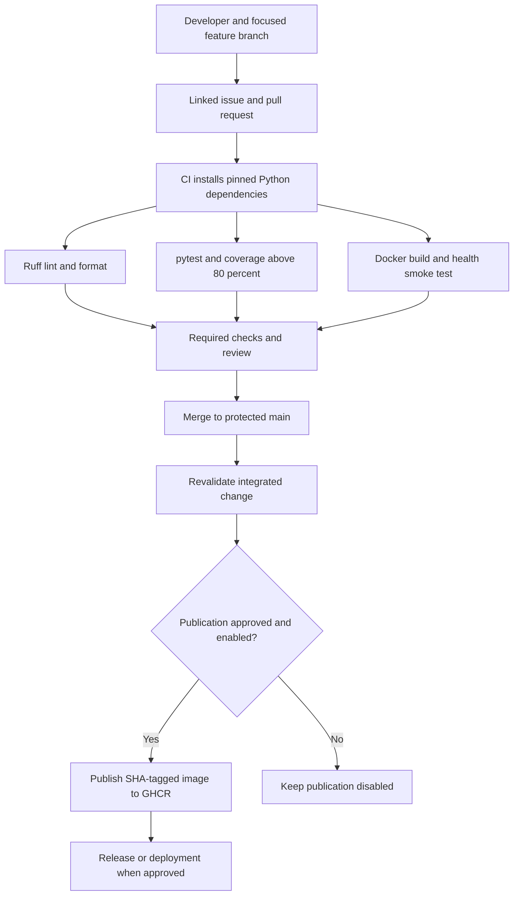

# DevOps architecture and working method

CI checks small integrated changes through lint, tests and packaging. Continuous delivery keeps a passing artifact ready for an approved release; continuous deployment would automatically release every passing change. This project implements verification and an approval-gated option to publish an image. It has no specified deployment host and does not claim a live deployment.

GitHub Flow suits this small application: one focused feature branch, linked issue and reviewed PR at a time; main stays stable. A separate develop branch adds little value here. A real CODEOWNERS rule needs maintainers with repository write access. Required checks must use actual GitHub check names, and the solo approval adaptation must be documented rather than inventing a second reviewer.

CI is read-only except for the trusted main publish job. Fork PR code is never published. The full commit SHA ties an image to source; package permissions and visibility must be reviewed before enabling publication. Use GitHub's built-in temporary token instead of committing credentials. The API itself needs no secrets.

The multi-stage Dockerfile separates installed runtime packages from the build stage and runs as a non-root account. The ignore file removes credentials, caches and test artifacts from the build context. The Python base tag should be reviewed and rebuilt for updates. Tags can change; pinning a reviewed base digest and action commit SHAs is a further reproducibility improvement. Scan dependencies and images with an approved scanner where available, review real findings and avoid claiming a clean scan unless it ran.

## Metrics to record from real runs

| Measure | How to obtain it | Current status |
| --- | --- | --- |
| First-run PR pass rate | Passing first CI runs divided by PRs | Verified successful runs; see `evidence/github-progress.md` |
| PR lead time | Open-to-merge timestamps | PR #8 created and merged on 17 October 2026; exact events are on GitHub |
| Build duration | Actions job timings | Verified successful runs; see `evidence/github-progress.md` |
| Coverage | Actual pytest-cov report | See local results |
| Deployment frequency | Approved deployment history | No target specified |
| Change failure rate | Failed releases divided by releases | Private GHCR artifact published; no application deployment |
| Recovery time | Incident start-to-restoration time | No production deployment or incident history |

These measures should improve feedback and reliability; they should not pressure rushed changes. No values are invented for missing observations.

## Initial retrospective

What worked: both documents describe compatible API requirements, allowing one project and one verification suite. What caused delay: the default Python command was inaccessible, and dependency installation initially hit temporary-folder permissions; using the bundled Python with a workspace temporary directory provided a path forward. Remaining work includes actual GitHub and Copilot access plus a Docker engine. Next improvement: confirm these prerequisites before the next practical session. Revisit this entry after real remote runs and board updates.

Version control, code review, repeatable checks, container artifacts and issue tracking form a traceable workflow. Configuration alone does not prove success: the final submission needs actual run logs and screenshots.

## References

- GitHub Actions: https://docs.github.com/actions
- Branch protection: https://docs.github.com/repositories/configuring-branches-and-merges-in-your-repository
- Dockerfile: https://docs.docker.com/reference/dockerfile/
- Multi-stage builds: https://docs.docker.com/build/building/multi-stage/
- GHCR: https://docs.github.com/packages/working-with-a-github-packages-registry/working-with-the-container-registry
- FastAPI testing: https://fastapi.tiangolo.com/tutorial/testing/
- pytest: https://docs.pytest.org/
- coverage.py: https://coverage.readthedocs.io/

## Remote execution retrospective

What worked: authenticated browser uploads preserved the project layout when terminal credentials were unavailable, and main/PR checks passed. The approved merge closed the CI issue and the approved main publisher produced a private SHA-tagged package. What delayed completion: Git credential-helper restrictions, private-repository branch-protection plan limits, missing local Docker, and Copilot authentication failing despite Free settings. Next improvement: verify IDE entitlement, a Docker engine and the required GitHub plan before the next practical. Source tests and hosted evidence are recorded separately from pending work.

## Subsequent verified update: 17 October 2026

User explicitly approved making the repository public to enforce protection. Visibility changed to Public; the main rule now applies to one branch without the earlier plan warning. PRs, up-to-date branches, lint/tests/container-build passing checks and administrator enforcement are configured; force pushes/deletion are disallowed. Independent approval remains off under the solo adaptation; CODEOWNERS still identifies the real owner. Earlier private/plan-limit screenshots are historical, superseded by 13-branch-protection-enforced.jpg and 14-public-repository.jpg.

Actual GitHub Copilot Free web assistance now succeeded: API, tests, numeric refactor, README/API reference and coverage-command explanation. See docs/copilot-evidence.md and evidence/copilot/ for genuine raw responses and accepted/rejected decisions. Two accepted tests bring the local suite to 30, all passing at 100% coverage; see evidence/local/results-after-copilot.txt. Earlier 28-test CI evidence remains historical. No IDE or Copilot CLI execution is claimed.

The remaining local Docker prerequisite is explicit: WSL and Docker Desktop were absent. User approved preparing official setup; docs/setup-docker.md supplies the exact owner steps. Administrator prompts, agreement and restart are for the user. Do not mark local Docker or the full-evidence issue complete until actual local execution succeeds. The private package/board have not been made public by the repository visibility change instruction.
